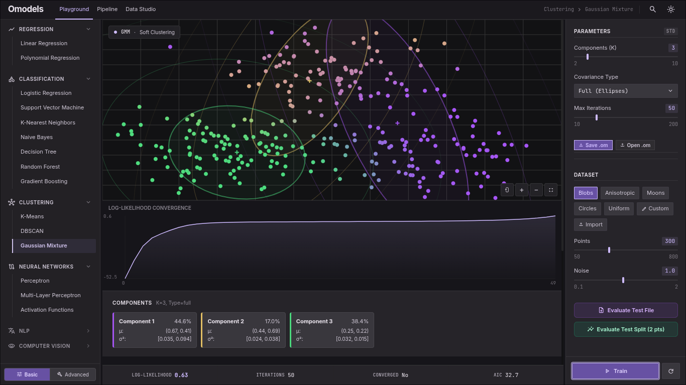
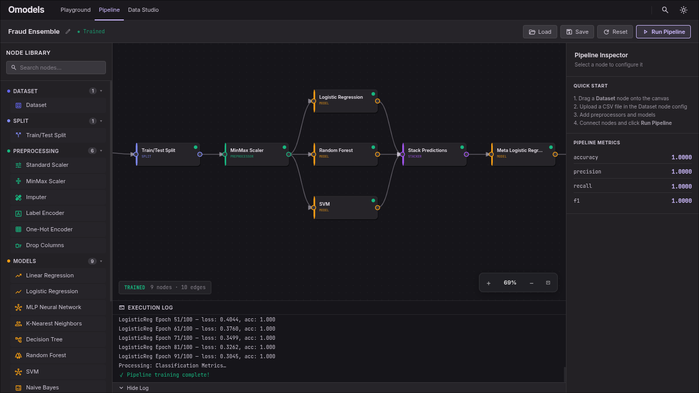
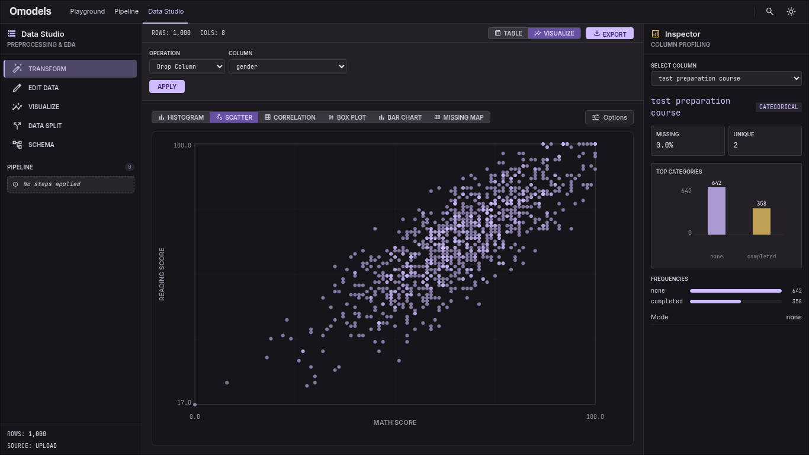

<div align="center">
  <h1>Omodels</h1>
  <p><b>A browser-based AI/ML learning and building platform — no installation, no server, no code required.</b></p>
  
  [](https://opensource.org/licenses/MIT)
  [](https://reactjs.org/)
  [](https://js.tensorflow.org/)
  
  <br />
</div>

Omodels is a serious, interactive machine learning environment where learning, experimenting, and building are the same activity. It bridges the gap between theoretical ML knowledge and practical implementation by letting you build, train, and run real models directly in your browser. 

Everything runs locally on your machine. No accounts, no cloud dependencies, no complex Python environments.

## ✨ Features

* 🎮 **Playground:** Interact with 16+ classical ML algorithms and deep learning architectures in real-time. See live loss curves, decision boundaries, and code generation as you tweak parameters.
* 🔗 **Pipeline Builder:** Construct complex ML pipelines using a node-based visual editor (DAG). Chain preprocessors, models, and ensembles together without writing code.
* 📊 **Data Studio:** Import, visualize, and clean tabular, image, text, and time-series data using built-in, browser-native tools.
* 💾 **Portable `.om` Format:** Export your entire workspace (datasets, models, and pipelines) as a single, portable `.om` JSON file to share or resume later.

## 📸 Screenshots

<p align="center">
  
  &nbsp;
  
</p>
<p align="center">
  
</p>

## 🛠️ Tech Stack

Omodels is built completely custom to maximize performance without relying on heavy external UI frameworks.

* **Frontend:** React 19, TypeScript, Vite
* **Styling:** Custom Vanilla CSS with CSS Variables (No external UI libraries)
* **ML Engine:** TensorFlow.js (WebGL backend for GPU-accelerated tensors)
* **Canvas Engine:** Custom SVG-based DAG rendering engine
* **Data Processing:** Papaparse (Web Workers), standard FileReader API
* **State Management:** Custom React Context (PipelineStore)

## 🚀 Getting Started

Since Omodels runs entirely in the browser, you can use the hosted version immediately (link coming soon), or run it locally for development.

### Local Development

1. **Clone the repository:**
   ```bash
   git clone https://github.com/abancp/omodels.git
   cd omodels/web
   ```

2. **Install dependencies:**
   ```bash
   npm install
   # or
   pnpm install
   ```

3. **Start the development server:**
   ```bash
   npm run dev
   # or
   pnpm run dev
   ```

4. Open your browser and navigate to `http://localhost:5173`.

## 🤝 Contributing

Contributions are welcome! Whether it's adding new models to the Playground, fixing bugs, or improving documentation.

1. Fork the Project
2. Create your Feature Branch (`git checkout -b feature/AmazingFeature`)
3. Commit your Changes (`git commit -m 'Add some AmazingFeature'`)
4. Push to the Branch (`git push origin feature/AmazingFeature`)
5. Open a Pull Request

## 📝 License

Distributed under the MIT License. See `LICENSE` for more information.

---
<div align="center">
  <i>Built to bridge the gap between intuition and implementation.</i>
</div>
